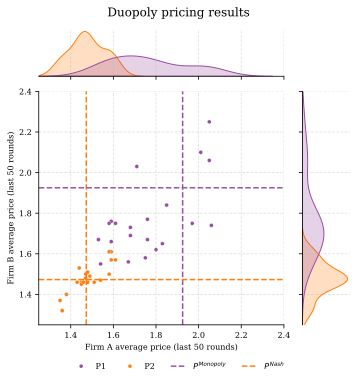
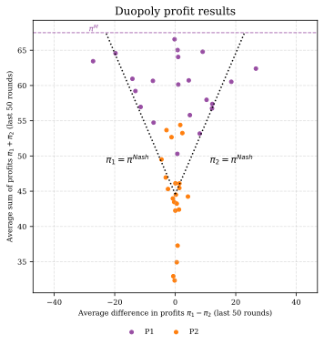
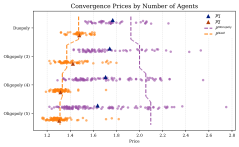
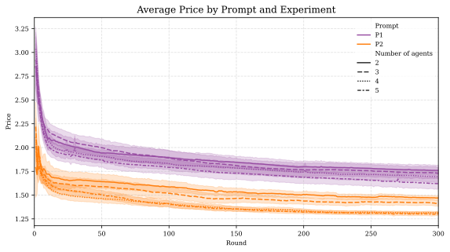
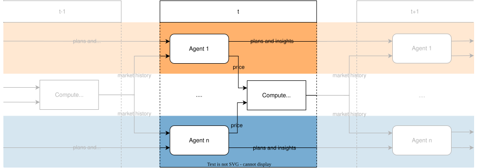

# Algorithmic Collusion and the Limits of Coordination

A Fish-style LLM duopoly/oligopoly pricing game, testing whether algorithmic collusion breaks down according to Folk Theorem predictions as market concentration decreases.

**Paper:** Fish, Gonczarowski & Shorrer (2025), *Algorithmic Collusion by Large Language Models* ([arXiv:2404.00806](https://arxiv.org/abs/2404.00806)) · Calvano, Calzolari, Denicolò & Pastorello (2020), *Artificial Intelligence, Algorithmic Pricing, and Collusion*, AER ([doi:10.1257/aer.20190623](https://doi.org/10.1257/aer.20190623))

[](https://opensource.org/licenses/MIT)
[](https://www.python.org/downloads/)
[](https://github.com/astral-sh/uv)

---

## Overview

This repository contains the research infrastructure for investigating whether algorithmic collusion among Large Language Model (LLM) agents breaks down according to Folk Theorem predictions as market concentration decreases. It is the **"Fish-style duopoly implementation" from the Collusion Research Sprint (project 1.1)**: a repeated two-seller pricing game, 300 rounds, visible history, persistent notes — trimmed to run on a 16 GB laptop with no GPU, calling models through the shared inference config, with the sprint's one-variable-at-a-time ablations exposed as command-line flags.

**Research Question**: Do LLM agent collusion mechanisms break down according to Folk Theorem predictions as the number of market participants increases from 2 to 5 agents?

**Key Innovation**: The first systematic test of theoretical collusion boundaries in AI-mediated markets, extending Fish et al. (2025) from duopoly to oligopoly settings. Unlike traditional RL algorithms requiring extensive training, LLMs arrive pre-trained on vast corpora about markets and strategic behavior, enabling sophisticated coordination strategies.

This project is a Master's thesis (BSE Data Science for Decision Making, 2024-2025): *Testing Folk Theorem Predictions in AI-Mediated Markets*.

**Authors**: Julian Romero, Lucia Sauer, Moritz Peist · **Institution**: Barcelona School of Economics · **Supervisor**: Christopher Rauh

---

## Setup

> **Fastest path:** from the repo root, `./setup.sh algorithmic-pricing-llms` sets this experiment up (deps + the shared `poseidon_compute` package) in one step; `./setup.sh` does all experiments. The manual steps below are equivalent.

### Install (CPU only, < 1 min)

```bash
uv sync
```

Requires Python 3.11+ and [uv](https://github.com/astral-sh/uv). For the analysis notebooks, also install the analysis extra: `uv sync --extra analysis`. The `text_analysis_*` notebooks additionally pull torch + sentence-transformers — request both extras in a single command, since `uv sync --extra` only keeps the extras named in that one invocation (running `uv sync --extra text` on its own would drop the analysis tooling): `uv sync --extra analysis --extra text`. Run the notebooks from the `notebooks/` directory — they read `../data/results/all_experiments.parquet` relative to it (Jupyter and `jupyter nbconvert` use the notebook's own folder as the working directory by default).

### Inference config

Inference is configured once in the **repo-root** `compute.env` (one level up from this experiment): copy it from the example and set your key.

```bash
cp ../compute.env.example ../compute.env   # at the repo root
# edit compute.env:  NEBIUS_API_KEY=...
```

Set a `NEBIUS_API_KEY` or `OPENROUTER_API_KEY` (either works for inference). The thesis default model is open and served by Nebius, so with an OpenRouter-only key pass an OpenRouter-served `--model`. See [`../COMPUTE.md`](../COMPUTE.md) for details.

> **If you only have an `OPENROUTER_API_KEY` (no Nebius key):** the scripts default the provider to `openrouter`, and the thesis default model id `mistralai/Mistral-Large-Instruct-2411` is **not** a valid OpenRouter model id (OpenRouter returns `400 … is not a valid model ID`). You must pass an OpenRouter-served model id explicitly, e.g. `--model openai/gpt-4.1-mini` (or set `MODEL_NAME` in the repo-root `compute.env`). All example commands below assume you add such a `--model` flag when running OpenRouter-only.

**Which variable sets the model?** These scripts read **`MODEL_NAME`**; the shared inference config reads **`LLM_MODEL`**. Both live in the repo-root `compute.env` (or the process environment). Precedence, highest first:

1. `--model <id>` (command line) — scope it to a single run
2. `MODEL_NAME` (repo-root `compute.env`) — this experiment's default
3. `LLM_MODEL` (repo-root `compute.env`) — forces one model id across *all* experiments
4. the thesis default, `mistralai/Mistral-Large-Instruct-2411`

So pass `--model` for a one-off, set `MODEL_NAME` for this experiment's default, or `LLM_MODEL` to pin the same model everywhere. The pre-run banner prints the model that actually resolves (nothing is silently swapped).

The default model is the thesis model, `mistralai/Mistral-Large-Instruct-2411` (open weights, served by Nebius).

---

## Quick start

Run the smoke test (positive control, ~60 calls):

```bash
uv run python experiments_synthetic/duopoly.py --rounds 30
```

If you are running OpenRouter-only (see the note under **Inference config**), add an OpenRouter-served model id, e.g.:

```bash
uv run python experiments_synthetic/duopoly.py --rounds 30 --model openai/gpt-4.1-mini
```

**Success signal**: the run ends with a summary of mean price over the last rounds against the Nash (competitive) and monopoly (collusive) prices, plus `Positive control: PASS/FAIL`. Only move on once it passes. The script always prints the total call count up front; it only pauses for a `Continue? [y/N]` confirmation when a run exceeds 100 calls (so the 30-round smoke test at ~60 calls runs without asking). Larger runs — e.g. the full 300-round control (~600 calls) — do prompt; skip that prompt with `-y`.

---

## Running experiments

The native commands below use the model from the repo-root `compute.env` (Nebius by default). **If you are running OpenRouter-only** (see the note under **Inference config**), add an OpenRouter-served `--model` id to every command below — e.g. `--model openai/gpt-4.1-mini` — or set `MODEL_NAME` in the repo-root `compute.env`; otherwise the default `mistralai/Mistral-Large-Instruct-2411` fails with `400 … is not a valid model ID`.

**Positive control** (defaults = one prompt, alpha 1, one seed):

```bash
uv run python experiments_synthetic/duopoly.py               # 300 rounds, ~600 calls
```

**Other market structures / baseline:**

```bash
uv run python experiments_synthetic/oligopoly_3.py
uv run python experiments_synthetic/oligopoly_4.py
uv run python experiments_synthetic/oligopoly_5.py
uv run python experiments_synthetic/monopoly.py    # baseline monopoly experiment
```

**Vary exactly one feature, hold the economics fixed** (one-variable ablations):

```bash
uv run python experiments_synthetic/duopoly.py --memory 0           # visible rounds: 0 / 10 / 100
uv run python experiments_synthetic/duopoly.py --no-notes           # PLANS/INSIGHTS scratchpad off
uv run python experiments_synthetic/oligopoly_3.py --shuffle-names  # competitor labels re-shuffled each round
uv run python experiments_synthetic/duopoly.py --temperature 1.0
uv run python experiments_synthetic/duopoly.py --memory 10 --seeds 1 2 3   # expand seeds after the control works
```

**Reproduce the thesis sweep:** `--prompts P1 P2`, `--alphas 1 3.2 10` and `--seeds`. Pass `--model <id>` to try any other open model (e.g. `meta-llama/Llama-3.3-70B-Instruct`, `Qwen/Qwen2.5-72B-Instruct`). `--help` lists everything.

**Pinning a model through the shared entry point.** To pin a specific model and let the shared config handle provider routing (Nebius → OpenRouter → Modal), run the same command through the repo-root entry point (one level up) — see [`../COMPUTE.md`](../COMPUTE.md):

```bash
poseidon-run --model <model id> -- uv run python experiments_synthetic/duopoly.py
```

---

## Outputs

Each run is a folder under `experiments_synthetic/experiments_runs/<n>_agents/`, named `<timestamp>_<settings>` (e.g. `2_agents/1792625342_duopoly_setting_P1_mem100_seed0`), containing:

- `metadata.json` — all settings + the run summary
- `results.json` — every answer
- `environment_history.parquet`
- `results_plot.svg`
- `log.txt` — full per-round run log (also useful for debugging a failed run)

**How to tell it worked**: the run completes with a printed summary and `Positive control: PASS/FAIL` against the Nash and monopoly benchmarks. Cost is rounds × firms calls per run; the script always prints this total up front and asks for confirmation only when it exceeds 100 calls (use `-y` to skip that prompt).

**Rough wall-clock** (hosted endpoint, ~1s/call rate limit, 2 firms): the `--rounds 30` smoke test (~60 calls) takes roughly 1–2 minutes; the full 300-round positive control (~600 calls) is on the order of 10–20 minutes. Larger `--firms`, `--seeds`, `--alphas`, or `--prompts` grids multiply this. Timings vary with endpoint latency.

The 216 original runs (203k rows, with the agents' full reasoning) are in `data/results/all_experiments.parquet` for the notebooks (`uv sync --extra analysis`).

---

## Analysis

```bash
# Start Jupyter for analysis
jupyter lab

# Key notebooks:
# - notebooks/regression.ipynb - Core statistical analysis
# - notebooks/plots.ipynb - Data visualization
# - notebooks/text_analysis_clusters.ipynb - Agent reasoning analysis
```

**Analysis Methodology**

*Run-Level Equilibrium Analysis:* Focus on final 50 periods (251-300) for convergence:
ln(Price_run) = β₀ + β₁·GroupSize + β₂·PromptType + X'γ + ε

*Textual Reasoning Analysis:*

- Clustering: HDBSCAN algorithm on sentence embeddings
- Validation: Human interpretation verification
- Strategic Patterns: Identification of reward-punishment language

*Robustness Testing:*

- Alternative aggregation windows (25, 75, 100 periods)
- Non-linear specifications with interaction terms
- Bootstrap confidence intervals
- Outlier sensitivity analysis

### Code Quality

```bash
# Lint and format code
ruff check
ruff format

# Run pre-commit hooks
pre-commit run --all-files
```

---

## Notes

**Common Issues:**

- **API Rate Limits**: Built-in rate limiting prevents overuse; adjust `rate_limit_seconds` if needed
- **Memory Usage**: Large experiments may require substantial RAM for data processing
- **Model Availability**: Ensure the shared inference config (`compute.env`) can reach the default model `mistralai/Mistral-Large-Instruct-2411` — served by Nebius, with the OpenRouter fallback for models Nebius doesn't serve

**Development Tips:**

- Use `notebooks/` for exploratory analysis
- Results are automatically saved in Parquet format in `data/results/`
- All experiment parameters are logged for reproducibility

---

## Repository Structure

```
algorithmic-collusion-thesis/
├── src/
│   ├── agents/              # LLM agent implementations
│   ├── environment/         # Market simulation (Calvano demand)
│   ├── experiment/          # Experiment orchestration
│   ├── prompts/             # Prompt engineering and management
│   ├── analysis/            # Statistical analysis tools
│   ├── plotting/            # Visualization utilities
│   └── utils/               # Utility functions and logging
├── experiments_synthetic/   # Experiment execution scripts
├── notebooks/              # Jupyter analysis notebooks
├── data/                   # Experimental data storage
├── latex/                  # Thesis manuscript and figures
└── pyproject.toml         # Dependencies (uv-managed)
```

**Core Components:**

- **LLM Agents**: Mistral API integration with 100-period rolling memory
- **Market Environment**: Calvano et al. (2020) demand specification with logit market shares
- **Experiment Framework**: 300-period repeated pricing games with rate limiting
- **Analysis Pipeline**: Statistical models and text analysis of agent reasoning

**Key Dependencies:**

- `polars` - High-performance DataFrame operations
- `mistralai` - LLM API integration
- `statsmodels/linearmodels` - Econometric analysis
- `seaborn/matplotlib` - Statistical visualization
- `sentence-transformers` - Text analysis and embeddings

---

## Key Findings

### Core Statistical Results

| Metric | Finding | Significance |
|--------|---------|-------------|
| **Group Size Effect** | **-3.7%** price reduction per additional competitor | ***p < 0.001*** |
| **Cumulative Impact** | **-10.6%** total price reduction (duopoly → 5-agent) | Highly significant |
| **Prompt Sensitivity** | **-18.8%** price difference between specifications | ***p < 0.001*** |
| **Model Explanatory Power** | **R² > 0.66** | Strong fit |

### Theoretical Validation

- **Strong empirical support** for Folk Theorem predictions
- **Smooth breakdown pattern** - coordination erosion follows predictable patterns
- **Robust across specifications** - effects consistent across alternative models
- **Independent prompt effects** - market structure remains fundamental determinant

### Economic Magnitude

Moving from duopoly (n=2) to five-agent competition (n=5):

- **Price reduction**: (e^(-0.0373 × 3) - 1) × 100% = -10.6%
- **Demonstrates**: Algorithmic collusion faces substantial constraints as market participants increase
- **Implication**: Quantitative evidence for theoretical predictions about coordination difficulty in larger groups

The **Folk Theorem** establishes that collusion requires δ ≥ (π^D - π^C)/π^D where π^C = π^M/n. As n increases, the required discount factor approaches 1, theoretically making collusion unsustainable.

---

## Experimental Results

### Monopoly Model Validation

| Model | Mean Price | Std. Dev. | Near 99% Profit | Outside Conv. Range |
|-------|------------|-----------|-----------------|-------------------|
| `mistral-large-2411` | **1.8028** | 0.0233 | **100%** | 0 |
| `magistral-small-2506` | 1.8083 | 0.1573 | 98% | 4 |

**Note**: Mistral-Large-2411 demonstrates superior convergence to monopoly pricing with zero periods outside convergence range.

### Duopoly Experiment Results

<div align="center">
  
  
</div>

**Key Observations:**

- Sustained supracompetitive pricing above Nash equilibrium
- Prompt-dependent coordination levels with systematic differences
- Reward-punishment mechanisms evidenced in price dynamics

### Oligopoly Breakdown Patterns

<div align="center">
  
</div>

**Folk Theorem Validation:**

- Systematic price erosion as group size increases
- Maintained coordination even in 5-agent settings
- Predictable degradation following theoretical predictions

### Run-Level Regression Results

```
Dependent Variable: ln(Price)
                    (1) Baseline    (2) With Controls
Group Size         -0.0373***      -0.0373***
                   (0.0055)        (0.0054)

P2 Prompt          -0.2082***      -0.2082***
                   (0.0125)        (0.0125)

α = 3.2                            0.0303**
                                   (0.0140)

α = 10.0                           0.0166
                                   (0.0157)

Constant           0.6573***       0.6417***
                   (0.0203)        (0.0218)

Observations       168             168
R-squared          0.666           0.675

Notes: *** p<0.01, ** p<0.05, * p<0.1
Robust standard errors (HC3) in parentheses.
```

<div align="center">
  
</div>

---

## Methodology

### Experimental Framework

**Synthetic Market Environment** → **LLM Agent Competition** → **Strategic Outcome Analysis**



**Experimental Design:**

- **Base Framework**: Extension of Fish et al. (2025) synthetic market simulation
- **Market Structures**: 2, 3, 4, 5 competing LLM agents
- **Game Duration**: 300-period repeated pricing games
- **Demand Function**: Calvano et al. (2020) specification for clean counterfactuals
- **Strategic Setting**: Bertrand competition with differentiated products

**LLM Implementation:**

- **Primary Model**: `mistral-large-2411` (superior convergence)
- **Alternative**: `magistral-small-2506` (robustness testing)
- **Prompt Engineering**: Two systematic specifications (P1, P2) testing coordination propensity
- **Memory Architecture**: 100-period rolling history for strategic learning

**Market Environment:**
Following the Calvano et al. (2020) logit demand specification (see the paper for the equations).

---

## License

This project is licensed under the MIT License. This research is conducted for academic purposes under standard fair use principles.

<div align="center">
  
</div>
